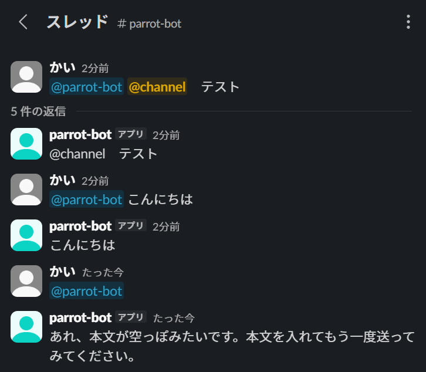

# slack-echo-bot

Slack でメンションされると、同じ文章をスレッドに返信する「オウム返し Bot」です。



上から順に、`@channel` が通知なしの文字になる様子、通常の返信、本文が空のときの案内です。

## 1. プロジェクト概要

| 項目 | 内容 |
|---|---|
| できること | `@bot こんにちは` とメンションすると、スレッドに「こんにちは」と返信する |
| 画像・ファイル付きのとき | 文章だけを返し、画像やファイルには対応していないことを伝える |
| 本文が空のとき | 本文が入っていないことを柔らかい表現で伝える |
| 動作環境 | 開発中:ローカル + ngrok/本番:Vercel |

## 2. 使用技術

| 分類 | 技術 |
|---|---|
| 言語 | JavaScript(Node.js 24、ESM) |
| フレームワーク | Slack Bolt for JavaScript(v5) |
| ホスティング | Vercel(Hobby プラン)、`@vercel/slack-bolt` |
| ローカル開発 | ngrok |
| テスト | Node.js 標準の `node:test` |

## 3. 処理の流れ

```
[ユーザー] @bot こんにちは
     │
     ▼
[Slack] app_mention イベント発生
     │  HTTP で POST(署名付き)
     ▼
[Bot(Bolt)]  ← 開発中は「自分の PC + ngrok」、本番は Vercel
     │  ① 署名を検証(偽のリクエストを弾く)
     │  ② 本文からメンション部分を取り除く
     │  ③ スレッドに返信する
     ▼
[Slack] スレッドに「こんにちは」と表示
```

## 4. セットアップ方法

### 必要なもの
- Node.js 24 以上
- Slack のワークスペース(テスト用を推奨)
- Vercel と GitHub のアカウント(本番にデプロイする場合)

### 1. Slack App を作る
1. [api.slack.com/apps](https://api.slack.com/apps) でアプリを作成する
2. **Bot Token Scopes** に、`app_mentions:read` と `chat:write` の2つだけを追加する
3. **Subscribe to bot events** に、`app_mention` を追加する
4. ワークスペースにインストールし、Bot をチャンネルに招待する(`/invite @Bot名`)
5. 次の2つの値を控える(**GitHub やチャットに載せない**)
   - Bot User OAuth Token(`xoxb-` で始まる):「OAuth & Permissions」
   - Signing Secret:「Basic Information」

### 2. 環境変数

| 名前 | 内容 | 使う場所 |
|---|---|---|
| `SLACK_BOT_TOKEN` | Bot User OAuth Token | ローカル・Vercel |
| `SLACK_SIGNING_SECRET` | Signing Secret | ローカル・Vercel |
| `PORT` | 待ち受けポート(省略すると 3000) | ローカルのみ |

### 3. ローカルで動かす(ngrok を使う)

```powershell
npm install
Copy-Item .env.example .env   # .env に、2つの値を書く
npm start                     # Bot が起動する
```

1. 別のターミナルで、ngrok で `3000` 番ポートを公開する(`ngrok http 3000`)
2. Slack の **Event Subscriptions** で、Request URL に `https://<ngrokのURL>/slack/events` を入れ、**Verified** を確認して保存する

### 4. Vercel にデプロイする
1. このリポジトリを GitHub に置き、Vercel で取り込む(Application Preset は「Other」)
2. Vercel の **Environment Variables** に、`SLACK_BOT_TOKEN` と `SLACK_SIGNING_SECRET` を登録する(Sensitive を推奨)
3. デプロイする
4. Slack の Request URL を `https://<プロジェクト名>.vercel.app/api/slack/events` に変更し、**Verified** を確認して保存する

### 5. テスト

```powershell
npm test
```

返信の判断と、二重処理の防止を、Slack なしで確認できる(10件)。

### ファイル構成

| ファイル | 役割 |
|---|---|
| `src/reply.js` | 返信する文章の判断(本文あり/なし、画像付き、一斉通知の無効化、スレッド先) |
| `src/dedupe.js` | 同じイベントを2回処理しないための記憶 |
| `src/handlers.js` | メンションを受けたときの処理(ローカルと Vercel で共通) |
| `src/app.js` | ローカル用の入口 |
| `api/slack/events.js` | Vercel 用の入口 |

## 5. 学んだこと

詳しくは [docs/learning-notes.md](docs/learning-notes.md) にまとめています。

- Slack App の作り方と、スコープ・イベント購読の考え方
- Bot トークンや Signing Secret など、秘密の値の扱い方
- Git は、`git init` を実行した場所を管理する。実行場所の確認が大切
- 管理画面は予告なく変わるので、手順書より実際の画面を見て判断する
- ウイルス対策ソフトが、開発ツール(ngrok)を削除することがある。例外設定と、署名の確認で対処できる
- 疎通の切り分けは、ngrok の記録と Bot のログの両方を見ると、「届いていない」のか「届いたが拒否した」のかが分かる
- 秘密の値がチャットやスクリーンショットに出たら、その場で失効させて作り直す
- 判断の部分を、Slack と切り離した関数にすると、テストしやすく、あとで使い回しやすい
- ライブラリの仕様は、公式の説明だけでなく、インストール済みのコードを読むと、確実に確認できる
- Vercel の関数は、リクエストが来たときだけ動く。ローカルの常時起動とは、受け口の作り方が違う
- 「Logs」(アクセスの記録)と「Deploy Logs」(ビルドの記録)は別物。調べたいことで、見る場所が変わる
- 動いたことと、再送や時間のかかるケースでも動くことは、別。確認できていないことは、分けて記録する

## 6. こだわった点

- **最小権限**:スコープは `app_mentions:read` と `chat:write` の2つだけ。イベントも `app_mention` だけ
- **秘密の値の管理**:トークンや Signing Secret は `.env` に置き、GitHub に上げない。画面に写ってしまったときは、その場で失効させて作り直した
- **原因が分からないことは、「未特定」と記録した**:分かったふりをせず、分かったことと分からないことを分けて、学習ノートに残している
- **`@channel` などの一斉通知を無効化**:本文をそのまま返しても、Bot が代わりに全員へ通知してしまわないようにした
- **ログに、本文やファイル名を出さない**:チャンネル、ファイル数、返信の長さだけを記録する
- **テストを10件つけた**:返信の4つの分岐と、スレッド先の判断、二重処理の防止を、Slack なしで確認できる
- **実際のイベントを見てから実装**:画像付きのイベントの形は、予想せず、実際に送って確認した
- **ローカルと本番で、同じ処理を使う**:返信の処理を `handlers.js` に切り出し、入口だけを分けた

## 7. 今後の改善案

- 二重処理の防止を、複数の環境(サーバーレスなど)でも効く方法にする。現在はメモリ上の記憶なので、サーバーレスでは効かない可能性があり、**Slack の再送が起きたときの動作は、未確認**
- しばらく使わなかったあとの最初のメンション(コールドスタート)が、3秒以内に収まるかを計測する(現在は、通常の状態で、2秒以内を1回確認しただけ)
- `@グループ`(ユーザーグループ)の一斉通知の扱いを確認し、必要なら無効化する

## 8. ライセンス

[MIT License](LICENSE)
